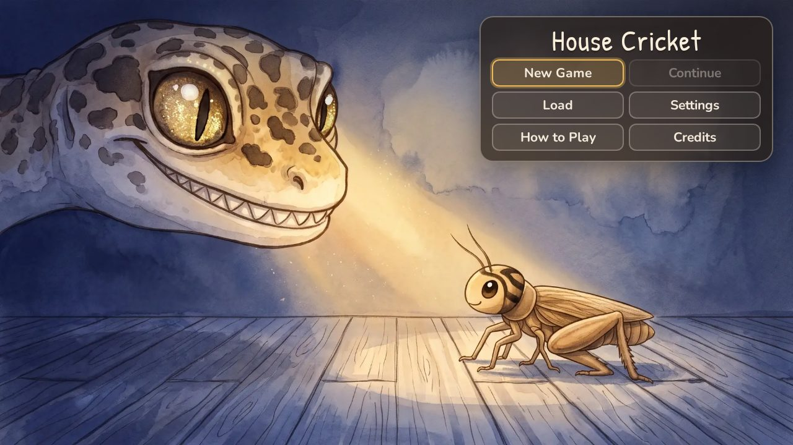
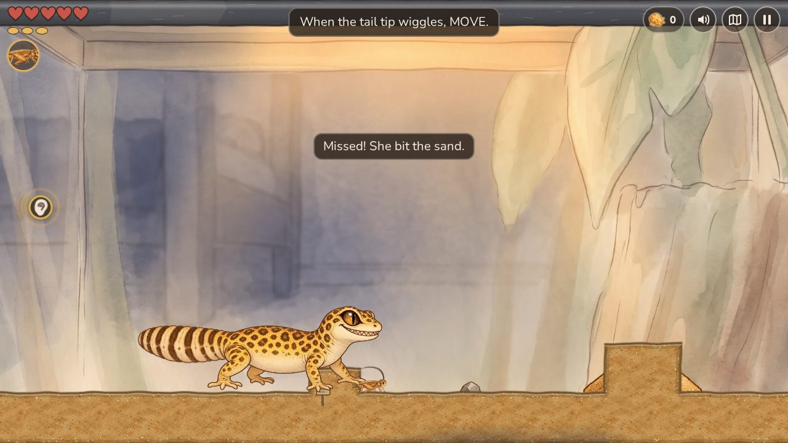
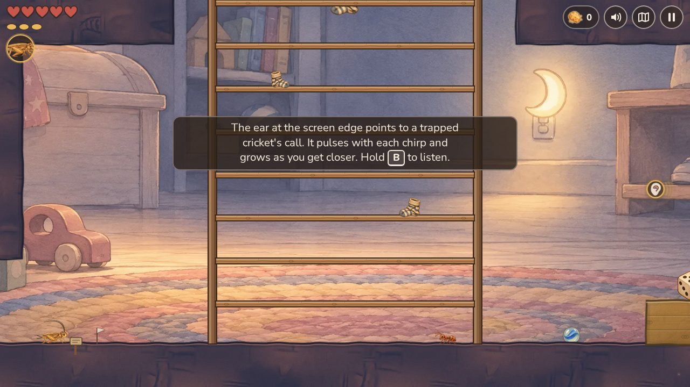
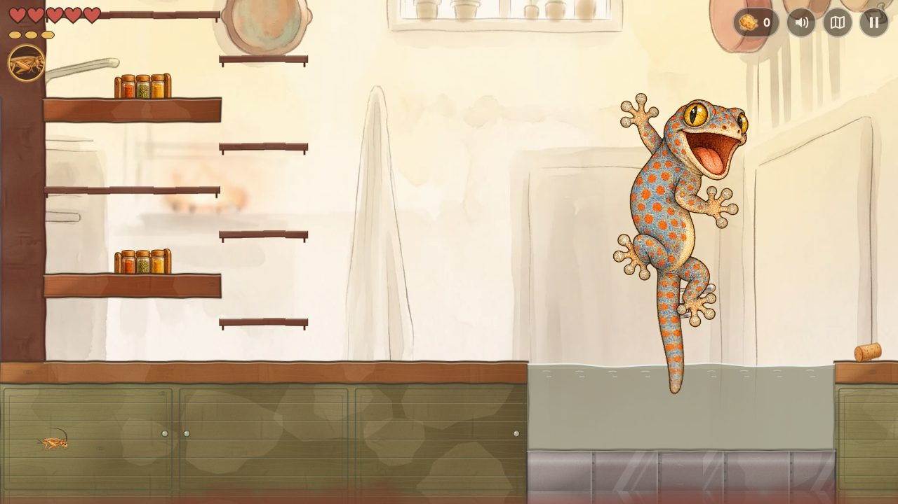
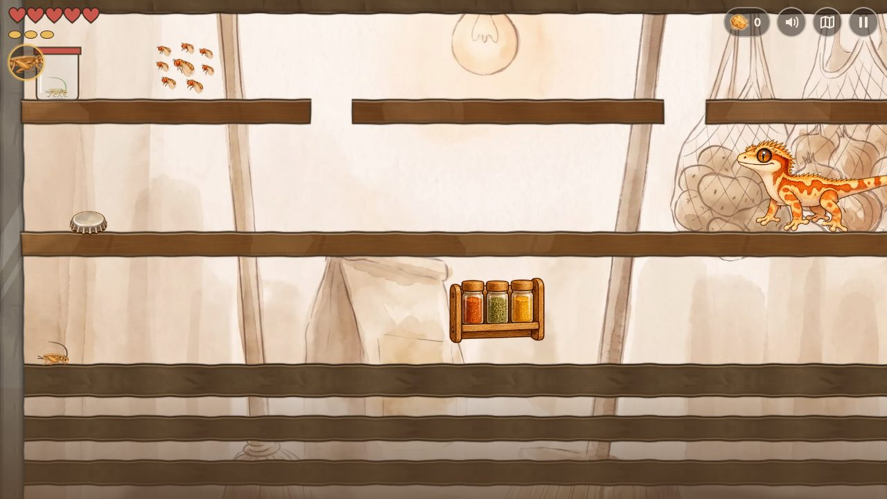
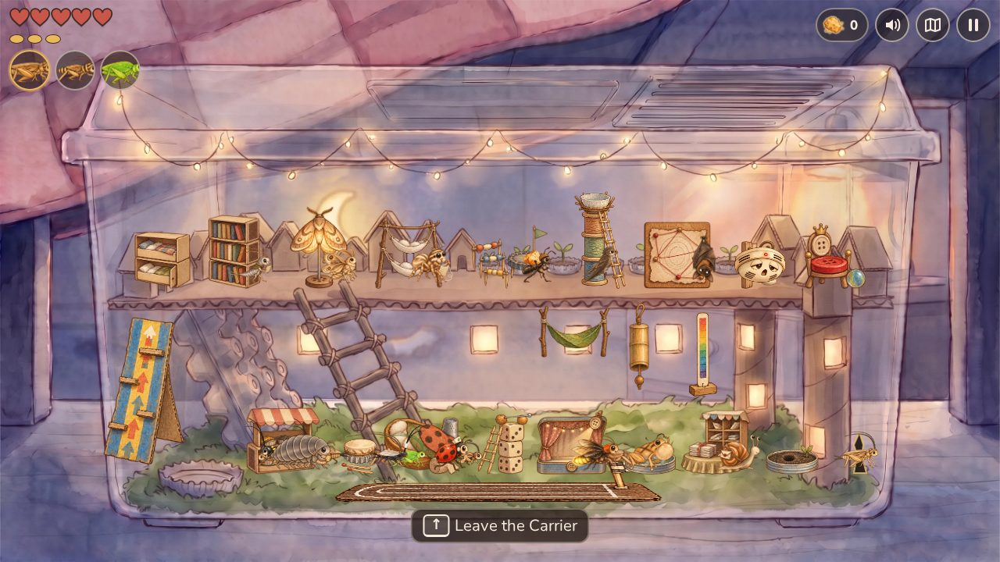
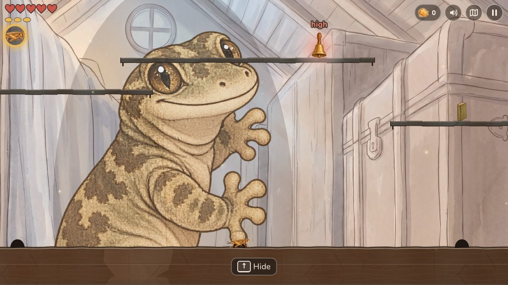

# House Cricket

*Bought as gecko food. Escaped. Coming back for everyone.*

You're Pip, a house cricket from a pet-store cup. You were meant to be Duchess the leopard gecko's dinner, but you got away. Your cupmates weren't so lucky. Ten of them are trapped in ten rooms of a big watercolor house, and each one is guarded by a gecko who is polite, toothy and very sorry you look delicious.

Follow each cricket's real chirp through one connected house. Find the household odds and ends that open new paths, and outwit every gecko without hurting a single one. Watch the Cricket Carrier grow from a bare plastic box into a little cricket town that sings.

**[▶ Play House Cricket](https://zeveck.github.io/house-cricket/)** in your browser. No install. It works on desktop and on phones, and plays start to finish with a controller.

## The house

| | |
|---|---|
|  **The tank.** Escape Duchess's tank and learn the one tell every gecko shares: a wiggling tail tip. |  **Ten rooms, painted in watercolor.** Bedroom, Bathroom, Kitchen, Pantry, Laundry, Living Room, Study, Sunroom, Basement and Attic, plus a hall, the stairs and the chimney. |
|  **Ten geckos, ten kinds of fight.** Avoid, hide, distract, lure with fruit, put to sleep, bonk with a pillow, play hide-and-seek, chase, dazzle, and sing a lullaby. Nobody gets hurt. |  **Real geckos with real habits.** Lashes has no eyelids, so he licks his eyeballs, and while he's licking he isn't looking. |
|  **The Cricket Carrier.** Every cricket and friend you bring home adds something: a chalk running track, a bamboo bell, a crumb shop, a library, a lily-pad pond. |  **The finale.** Everyone you rescued sings giant Nana to sleep. |

There are 11 crickets you can swap between, each a real species with its own real song, built from measurements of real cricket chirps. There are 18 kinds of household critter, darkling beetles and a robot vacuum you have to hide from, and a crew of things that chirp but are *not* crickets: a tired smoke alarm, a chirping gecko, a tree frog, a chimney swift who is sick of being called a sparrow, and a bat. Somewhere behind the basement furnace, a bearded dragon guards a hoard.

## How to play

| Action | Keyboard | Controller | Phone |
|---|---|---|---|
| Move | ← → or A D | left stick / d-pad | the stick, left thumb |
| Jump (hold for higher; press again in the air to flutter; hold while falling to glide) | Space / Z | ✕ (A) | Jump |
| Chirp: call out, stun bugs, wake things up | C / K | △ (Y) | Chirp |
| Kick | X / J | □ (X) | Kick |
| Listen for the trapped cricket (hold) | B / L | ○ (B) | Ear |
| Use an item (swing, super-jump, glow) | V / I | R2 | Use |
| Hide (next to a crack or bottle cap) | ↑ / W | stick up | stick up |
| Swap cricket | Q / E | L1 / R1 | tap a face |
| Map · Pause · Mute | Tab · Esc · M | Create · Options | top-right icons |

- **On a phone:** hold it sideways and use the on-screen buttons. You can install the game from your browser's menu to play full screen, even offline.
- **With a controller:** plug in a PS5 controller (USB or Bluetooth) and press any button. It works best in Chrome or Edge, and Xbox and other controllers work too.
- **Following the chirp:** listen for the trapped cricket's chirp. The ear at the edge of the screen points toward it and pulses with each chirp, and the chirp gets louder as you get closer.
- **Losing and saving:** there's no game over. A fall costs one heart and puts you back on solid ground, and losing a gecko fight restarts only that part of the fight. Save at the cracks in the baseboards (three save slots). Every crack can take you home to the Carrier.
- **Gentle Mode:** in Settings, it halves damage and slows the geckos' warnings.

## Playing locally

House Cricket is a plain web page with no build step. Serve the `game` folder with any static web server, for example:

    cd game
    python3 -m http.server 8000

then open http://localhost:8000. Opening the file directly by double-clicking won't work, because browsers don't run games from files on disk.

## Credits

- An idea by Rich Conlan.
- Fonts: [Patrick Hand](https://fonts.google.com/specimen/Patrick+Hand) and [Nunito](https://fonts.google.com/specimen/Nunito), under the SIL Open Font License (bundled in `game/fonts/` with their licenses).
- Bug reports use [gh-feedback](https://github.com/zeveck/gh-feedback).
